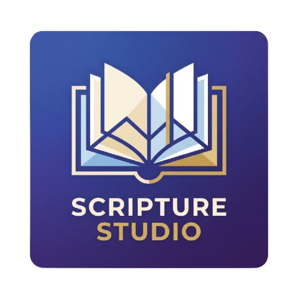
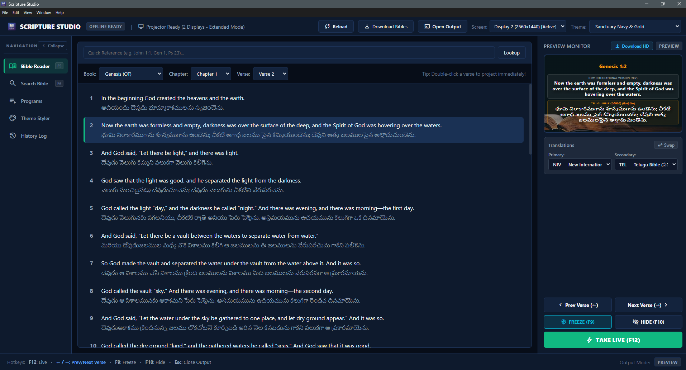

# Scripture Studio 

> **An independent, modern, offline-first church presentation and scripture projection desktop application for Windows.**


---

## Overview

**Scripture Studio** is an open, modern desktop application engineered to replace legacy church presentation software like BibleShow. It is specifically designed for live worship environments requiring high reliability, sub-100ms scripture lookups, multi-monitor management, stage confidence monitoring, and native live-streaming integration with OBS Studio and vMix.

### Key Architectural Characteristics
- **Windows Desktop First:** Built with Electron 34, React 19, and TypeScript for rock-solid multi-monitor window management.
- **Offline First:** 100% operational without an internet connection using local SQLite 3 with Write-Ahead Logging (WAL) and FTS5 full-text search.
- **Decoupled Engines:** Core presentation runtime and Bible query engines are strictly separated from operator UI components.
- **Deterministic Presentation Pipeline:** Independent Preview and Live outputs with discrete Freeze, Hide, Clear, and AutoPlay controls.
- **Multi-Display & Stage Display:** Simultaneous management of Control Studio, Audience Projector, and Stage Confidence Monitor with private speaker notes.
- **Streaming Ready:** Real-time atomic XML and PNG disk export plus native NewTek NDI video streaming adapter.



---

## Documentation (Milestone M0 Deliverables)

The complete product discovery, system architecture, database design, and test plans are available in the [`docs/`](docs/) directory:

- 📄 [Product Requirements Document (PRD)](docs/PRD.md)
- 📋 [Feature Parity & Traceability Matrix](docs/FEATURE-MATRIX.md)
- 🏗️ [System Architecture & Engines](docs/ARCHITECTURE.md)
- 👥 [Agent Ownership & Governance Matrix](docs/AGENT-OWNERSHIP.md)
- 💾 [Database Schema & SQLite DDL](docs/DATABASE.md)
- 🔌 [Electron IPC Communication Contracts](docs/IPC-CONTRACTS.md)
- 🎨 [UI/UX & Display Layout Specification](docs/UI-SPECIFICATION.md)
- 🔒 [Desktop Security & Hardening Model](docs/SECURITY.md)
- 🧪 [Test Strategy & Acceptance Criteria](docs/TESTING.md)
- 🗺️ [Engineering Roadmap (M0–M10)](docs/ROADMAP.md)
- ⚠️ [Risk Register & Mitigation Matrix](docs/RISK-REGISTER.md)
- ☁️ [Cloud Sync & Remote Control API Contracts](docs/API-CONTRACTS.md)
- 📐 [ADR-001: Modular Monolith with Electron](docs/decisions/ADR-001-modular-monolith-electron.md)

---

## Technology Stack

| Layer | Selected Technology |
| :--- | :--- |
| **Desktop Runtime** | Electron (Windows 10/11 64-bit) |
| **Frontend Framework** | React 19 + TypeScript |
| **Build Tooling** | Vite + pnpm Workspaces |
| **UI Components** | Custom Church Media Design System + MUI |
| **State Management** | Zustand (Local) + Typed IPC Event Bus (Presentation) |
| **Local Database** | SQLite 3 (`better-sqlite3` with WAL Mode + FTS5) |
| **Media Playback** | HTML5 Video (Hardware Accelerated) + Web Animations API |
| **Broadcast Streaming** | NewTek NDI SDK + Atomic Disk Exporter (XML / PNG) |
| **Test Suites** | Vitest + React Testing Library + Playwright Desktop |
| **Packaging** | Electron Builder (NSIS / MSI Installers) |
| **Optional Cloud** | ASP.NET Core 9 Web API + WebSockets |

---

## Monorepo Layout

```
scripture-studio/
├── apps/
│   └── desktop/                  # Electron main, preload, and React renderers
│       ├── electron/             # Main process, window manager, IPC handlers
│       │   ├── main/
│       │   ├── preload/
│       │   └── windows/
│       └── renderer/             # React 19 operator UI, audience canvas, stage canvas
├── packages/
│   ├── shared-types/             # Shared TypeScript DTOs, enums, contracts
│   ├── database/                 # SQLite repository, schema migrations, FTS5
│   ├── bible-engine/             # Canonical 66-book logic, versification mapping
│   ├── bible-importer/           # Parser for open-format JSON, XML, OSIS, USFM
│   ├── scripture-search/         # Natural reference parser & FTS5 search engine
│   ├── presentation-engine/      # PresentationController & state machine
│   ├── theme-engine/             # WYSIWYG theme compiler & safe-margin calculator
│   ├── media-engine/             # Seamless video looper & asset loader
│   ├── display-manager/          # Windows multi-monitor detection & window bounds
│   ├── streaming-engine/         # Real-time XML/PNG disk export & NDI adapter
│   ├── keyboard-shortcuts/       # Hotkey registry & global keyboard shortcuts
│   ├── ui-library/               # Design tokens & high-density desktop components
│   ├── logger/                   # Structured logging
│   └── configuration/            # Application settings & user preferences
├── backend/                      # Optional ASP.NET Core cloud service & API
├── docs/                         # Milestone discovery, PRD, and architecture specs
└── tests/                        # Monorepo test suites (unit, integration, e2e)
```

---

## Project Status

- [x] **Milestone M0: Product Discovery and Architecture** (Complete)
- [x] **Milestone M1: Desktop Foundation & Shell** (Complete)
- [x] **Milestone M2: Application Shell & UI Design System** (Complete)
- [x] **Milestone M3: Bible Engine & Importer** (Complete)
- [x] **Milestone M4: Scripture Search & Reference Parser** (Complete)
- [x] **Milestone M5: Presentation Engine & Live Controls** (Complete)
- [x] **Milestone M6: Programs, Themes & History Log** (Complete)
- [x] **Milestone M7: Advanced Desktop, Multi-Monitor & Stage Display** (Complete)
- [x] **Milestone M8: Streaming & Broadcast Integrations (NDI/XML/PNG)** (Complete)
- [x] **Milestone M9: Cloud Sync & Mobile Remote** (Complete)
- [x] **Milestone M10: Production Hardening, Installer & Release** (Complete)

---

## License & Legal Compliance

Scripture Studio is developed as an independent, clean-room software application. It contains no proprietary code, binary assets, or closed modules from BibleShow or any third-party commercial presentation software. All Bible datasets utilized in automated testing and sample packaging are public domain or openly licensed with verified attribution.

