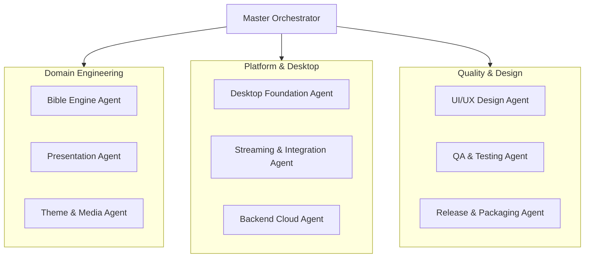

# Scripture Studio — Agent Ownership & Responsibility Matrix

**Document Version:** 1.0.0  
**Status:** Approved for Architecture Review (Milestone M0)  
**Governance:** Master Orchestrator Approval Required for Contract Mutations  

---

## 1. Agent Roles & Specialization

To prevent chaotic cross-contamination and build conflicts across the monorepo, each software engineering subagent operates under strict file ownership boundaries and documented interface contracts.

---

## 2. Agent Ownership Matrix

| Agent | Responsibility Scope | Primary Owned Paths | Primary Deliverables |
| :--- | :--- | :--- | :--- |
| **Master Orchestrator** | Monorepo governance, roadmap tracking, dependency coordination, architecture gates. | `docs/ROADMAP.md` `docs/AGENT-OWNERSHIP.md` `pnpm-workspace.yaml` | Milestone sign-offs, pull request approvals, release gating. |
| **Architect Agent** | Technical design records, interface schemas, IPC contracts, database normalization. | `docs/ARCHITECTURE.md` `docs/DATABASE.md` `docs/IPC-CONTRACTS.md` `packages/shared-types/**` | Architecture Decision Records (ADRs), contract schemas. |
| **Desktop Agent** | Electron lifecycle, native window management, display topology, secure preload, OS integrations. | `apps/desktop/electron/**` `packages/display-manager/**` `packages/keyboard-shortcuts/**` | Window managers, secure preload bridge, monitor listeners. |
| **Bible Engine Agent** | Scripture models, parser grammar, FTS5 full-text indexing, multi-format Bible importer. | `packages/bible-engine/**` `packages/bible-importer/**` `packages/scripture-search/**` `packages/database/**` | Bible repository, reference parser, import pipeline, search. |
| **Presentation Agent** | Centralized PresentationController, slide state machine, history logger, AutoPlay. | `packages/presentation-engine/**` `apps/desktop/renderer/src/features/presentation/**` | Presentation state engine, command queue, slide bus. |
| **Theme & Media Agent** | Typography styler, safe-margin calculator, gradient/video backgrounds, lower-thirds. | `packages/theme-engine/**` `packages/media-engine/**` `apps/desktop/renderer/src/features/themes/**` | Theme editor, background renderer, video looper. |
| **UI/UX Design Agent** | Control studio layouts, design system tokens, accessible components, responsive navigation. | `packages/ui-library/**` `apps/desktop/renderer/src/app/**` `apps/desktop/renderer/src/components/**` | Reusable UI components, workspace layouts, dark/light themes. |
| **Streaming Agent** | Real-time XML/PNG disk export, NDI video streaming adapter, broadcast health diagnostics. | `packages/streaming-engine/**` `apps/desktop/electron/streaming/**` | NDI C++ adapter, atomic disk writer, vMix/OBS feeds. |
| **Backend Agent** | Optional ASP.NET Core cloud service, remote control WebSockets, REST APIs. | `backend/**` `docs/API-CONTRACTS.md` | ASP.NET Core API, sermon sync endpoints, mobile remote. |
| **QA Agent** | Automated test suites, Playwright E2E tests, multi-monitor mocks, benchmark verifications. | `tests/**` `docs/TESTING.md` | Unit/integration/E2E tests, performance benchmark logs. |
| **Release Agent** | Electron Builder packaging, Windows installers (NSIS/MSI), CI/CD workflows, release notes. | `.github/workflows/**` `scripts/**` `package.json` | Distributable installers, release builds, changelog. |

---

## 3. Collaboration & Communication Rules

### 3.1 Strict Anti-Corruption Boundaries
1. **Contract Immutability:** No agent may modify files under `packages/shared-types/` or `docs/IPC-CONTRACTS.md` without an approved proposal submitted to the **Master Orchestrator** and **Architect Agent**.
2. **No Direct Package Tampering:**
   - The UI Agent may **never** write directly to `packages/database/` or `packages/bible-engine/`.
   - The Presentation Agent communicates with the Bible Engine exclusively through exported repository interfaces.
   - The Desktop Agent never embeds presentation formatting or business logic into Electron main processes.
3. **Unidirectional Imports:**
   - Packages in `packages/*` must never import from `apps/*`.
   - `apps/desktop/renderer` must never import from `apps/desktop/electron`.

### 3.2 Change Management Protocol
When an agent completes a task within its milestone:
1. Ensure all local unit and integration tests pass cleanly.
2. Confirm strict TypeScript compliance (`tsc --noEmit`).
3. Document any newly created IPC channels or shared models.
4. Notify the Orchestrator with:
   - Specific files modified.
   - Test suites executed and pass rate.
   - Identified edge cases or limitations.
   - Next dependent agent unblocked.

---

## 4. Agent Quality Gates (Exit Criteria)

Before any feature branch or module is marked complete, it must pass all 6 Quality Gates:
- **Gate 1 (Requirements):** Traceable to a Feature ID in `FEATURE-MATRIX.md`.
- **Gate 2 (Architecture):** Conforms to `ARCHITECTURE.md` with zero circular dependencies.
- **Gate 3 (Implementation):** Strict TypeScript, zero unexplained `any`, robust error boundaries.
- **Gate 4 (Testing):** ≥85% code coverage for domain logic; all integration tests pass.
- **Gate 5 (Security):** Sandbox intact, no unprotected IPC handlers, no hardcoded secrets.
- **Gate 6 (Review):** Peer review by QA Agent and final merge approval by Master Orchestrator.

