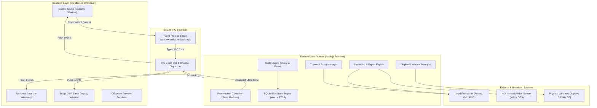
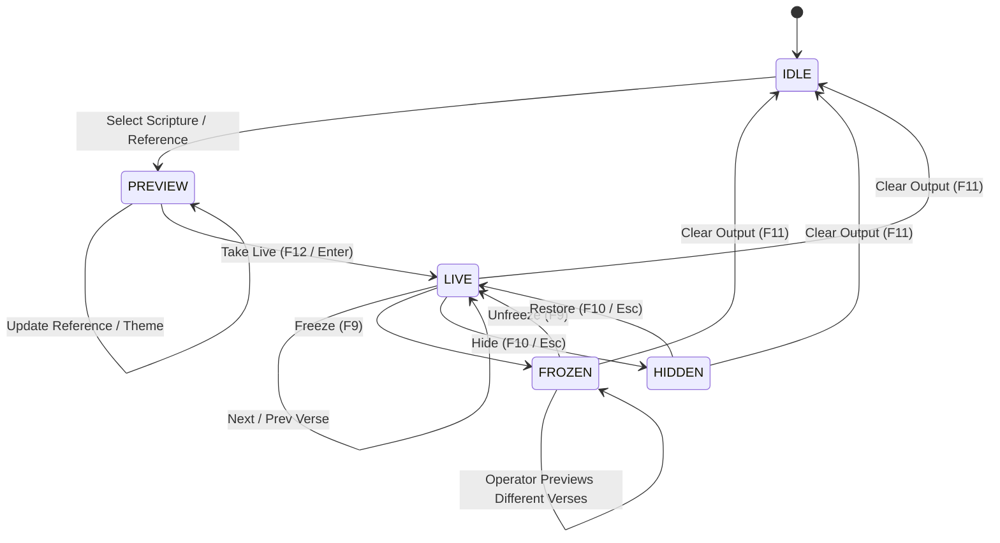
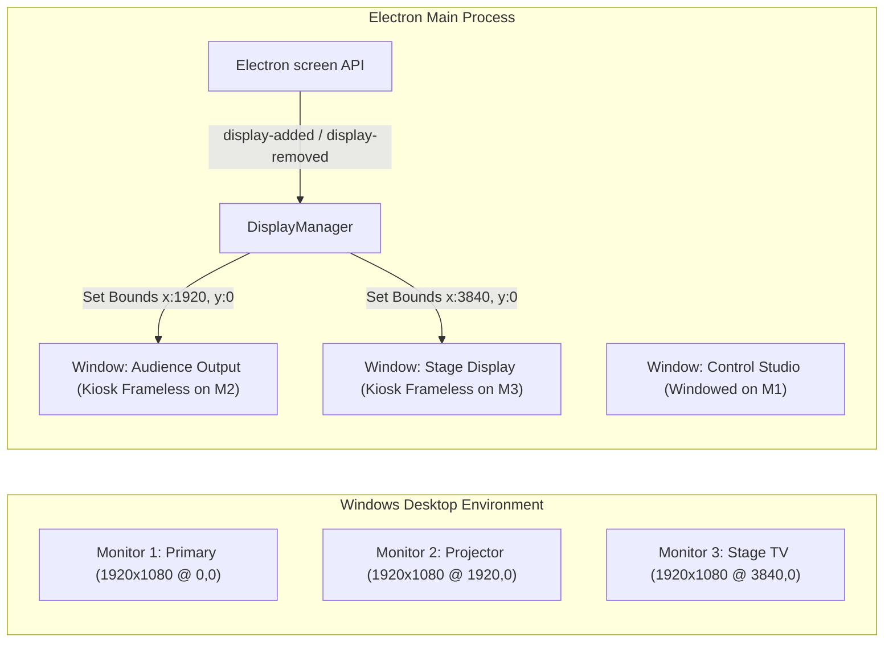

# Scripture Studio — System & Module Architecture

**Document Version:** 1.0.0  
**Status:** Approved for Architecture Review (Milestone M0)  
**Primary Framework:** Electron + React 19 + TypeScript + SQLite  

---

## 1. Architectural Philosophy & Principles

### 1.1 The Golden Rule of Live Church Software
**The presentation runtime must never be coupled to the control UI.**  
In Scripture Studio, the operator's workspace (searching books, configuring themes, sorting playlists, browsing preferences) operates completely decoupled from the audience projection and stage display surfaces. If an operator opens a heavy settings dialog, triggers a full-text search across 5 Bible translations, or experiences a UI re-render, the audience screen must remain 100% steady, locked at 60 FPS without frame stutter or visual disruption.

### 1.2 Core Architectural Principles
1. **Modular Monolith:** Domain logic is organized into decoupled TypeScript packages with strictly unidirectional dependencies.
2. **Offline-First:** All core operations (database lookup, presentation controller, theme rendering, multi-screen management, NDI broadcasting) execute entirely locally with zero internet dependencies.
3. **Deterministic Rendering:** Given a specific verse text, theme definition, and screen aspect ratio, the rendering engine produces an identical visual output across Preview, Live Projector, Stage Monitor, PNG snapshots, and NDI streams.
4. **Strict Electron Security Boundary:** Renderers operate in a sandboxed, context-isolated environment with zero direct access to Node.js APIs or the operating system. All communication flows through a strongly typed, allowlisted IPC bridge.

---

## 2. High-Level System Architecture



---

## 3. The Five Core Engines

| Engine | Responsibility | Explicit Prohibitions |
| :--- | :--- | :--- |
| **Bible Engine** (`@scripture-studio/bible-engine`) | Canonical book order, verse resolution, range aggregation, reference parsing, translation metadata, versification mapping. | **Must not** depend on React, DOM APIs, or presentation state. |
| **Presentation Engine** (`@scripture-studio/presentation-engine`) | Slide state machine, Preview vs Live management, Freeze/Hide/Clear execution, command serialization, history tracking. | **Must not** depend on UI components, window handles, or direct monitor APIs. |
| **Theme Engine** (`@scripture-studio/theme-engine`) | Visual style modeling, CSS rule generation, typography calculations, safe-margin enforcement, gradient/media layer resolution. | **Must not** depend on Bible database or monitor management. |
| **Display Manager** (`@scripture-studio/display-manager`) | Windows monitor enumeration, display topology tracking, multi-window lifecycle, borderless full-screen positioning, disconnect handling. | **Must not** depend on scripture content or theme styles. |
| **Streaming Engine** (`@scripture-studio/streaming-engine`) | Real-time XML data export, transparent PNG rendering, NDI video frame packaging, broadcast status monitoring. | **Must not** depend on operator UI components. |

### 3.1 Interaction Workflow Example
When an operator searches and projects **Romans 8:28**:
1. **Bible Engine** parses the reference and retrieves the verse record from SQLite (`romans-8-28`).
2. **Theme Engine** resolves the active presentation theme (font, shadow, background asset).
3. **Presentation Controller** receives the verse payload and updates `previewState`.
4. Operator reviews the slide in the Preview pane and presses `Take Live` (`F12`).
5. **Presentation Controller** transitions from `PREVIEW` to `LIVE`, commits the payload to `liveState`, and appends an entry to `presentation_history`.
6. Electron IPC broadcasts `presentation:state-changed` to all connected renderers.
7. **Audience Display** transitions smoothly to the new slide.
8. **Stage Display** updates its "Current Verse" canvas and automatically pre-fetches Romans 8:29 into the "Next Verse" box.
9. **Streaming Engine** writes `current_verse.xml`, exports `current_slide.png`, and streams the updated BGRA frame via NDI to the broadcast switcher.

---

## 4. Presentation State Machine

The presentation engine uses an explicit, finite state machine to guarantee that live projection is deterministic and immune to race conditions caused by rapid keyboard navigation.



### 4.1 State Definitions
* **`IDLE`:** No active slide is broadcast to the audience. Audience screen displays black, transparent, or default church logo/wallpaper.
* **`PREVIEW`:** Content is staged in the operator's preview pane. The audience display remains untouched.
* **`LIVE`:** Audience display actively renders the current live scripture. State changes (next verse, theme update) immediately update the screen.
* **`FROZEN`:** Audience screen output is locked to the current graphical frame. The operator can navigate, search, and preview new scriptures in the control room without altering the audience view.
* **`HIDDEN`:** Audience screen is blanked (cut to black or transparency) for moments of prayer or meditation while preserving the active scripture in memory for instantaneous recall.

---

## 5. Monorepo Package Dependency Graph

```
scripture-studio/
├── apps/
│   └── desktop/                  # Electron main, preload, and React renderers
└── packages/
    ├── shared-types/             # Universal types, interfaces, and enums
    ├── database/                 # SQLite repository, schema, migrations, FTS5
    ├── bible-engine/             # Canonical Bible logic & versification
    ├── bible-importer/           # Parser for OSIS, USFM, Zefania XML, JSON
    ├── scripture-search/         # Reference parser & FTS5 search engine
    ├── presentation-engine/      # PresentationController & state machine
    ├── theme-engine/             # Theme models, CSS compilers, safe margins
    ├── media-engine/             # Video looping & asset management
    ├── display-manager/          # Windows multi-monitor detection & window bounds
    ├── streaming-engine/         # XML, PNG, and NDI broadcast adapters
    ├── keyboard-shortcuts/       # Ergonomic hotkey registry & listeners
    ├── ui-library/               # Reusable React components & design system
    ├── logger/                   # Structured logging (main & renderer)
    └── configuration/            # App settings & user preferences
```

### 5.1 Strict Dependency Rules
* `packages/shared-types` has **zero** dependencies.
* `packages/bible-engine` depends only on `shared-types` and `database`.
* `packages/presentation-engine` depends only on `shared-types`, `theme-engine`, and `bible-engine`.
* `apps/desktop/renderer` depends on `packages/ui-library`, `packages/shared-types`, and React 19. It **never** imports `packages/database`, Electron, or Node.js built-ins.
* Circular dependencies are prohibited and enforced via ESLint boundaries.

---

## 6. Multi-Display Architecture & Coordinate Mapping



### 6.1 Disconnection & Reconnection Strategy
* **Physical Unplug (e.g. HDMI Cable Pulled):**
  1. Windows OS fires display removal event.
  2. Electron `screen.on('display-removed')` triggers `DisplayManager`.
  3. `DisplayManager` marks the audience display as `DISCONNECTED`.
  4. The associated `BrowserWindow` is cleanly hidden or closed to prevent offscreen rendering leaks.
  5. The Control Studio UI immediately surfaces an amber banner: *"Audience Display Disconnected"*. Presentation state remains fully intact in memory.
* **Reconnection:**
  1. Cable reconnected; `screen.on('display-added')` fires.
  2. `DisplayManager` prompts operator: *"Audience Display Detected on Display 2. Restore Output?"*
  3. Window re-opens at exact display bounds; Presentation Controller automatically re-pushes current live state.

---

## 7. Streaming & Broadcast Integration Architecture

### 7.1 NDI Adapter Architecture
NDI (Network Device Interface) allows sending 1080p60 / 4K video feeds with transparency over local gigabit Ethernet.
* To maintain stability across different Windows environments, the NDI integration is isolated behind a native adapter interface (`INdiAdapter`).
* If the user system lacks NDI runtimes, Scripture Studio falls back gracefully to a null adapter, logging a diagnostic message rather than failing application startup.
* The streaming pipeline captures frames from an offscreen Chromium canvas, converts to BGRA format, and pushes them to the NDI sender buffer.

### 7.2 Zero-Contention Disk Export (XML & PNG)
To feed broadcast software like vMix or OBS without triggering file-read locking errors:
1. Scripture Studio renders the live slide into an offscreen canvas.
2. The PNG buffer is written to a temporary file (`current_slide.png.tmp`).
3. An atomic filesystem rename (`renameSync`) replaces `current_slide.png`.
4. XML scripture metadata follows the identical atomic swap pattern, guaranteeing that external software never reads a partially written file.

---

## 8. Data Persistence Architecture

### 8.1 SQLite Configuration
* **Database Driver:** `better-sqlite3` (synchronous, high-performance C++ binding) running exclusively in the Electron Main process.
* **Journal Mode:** `PRAGMA journal_mode = WAL;` (Write-Ahead Logging ensures concurrent read performance without blocking writer transactions).
* **Synchronous Setting:** `PRAGMA synchronous = NORMAL;` (balances write performance with Sunday morning power-loss safety).
* **Foreign Keys:** `PRAGMA foreign_keys = ON;`.
* **Full-Text Search:** Virtual tables backed by SQLite FTS5 extension with unicode61 tokenizer.

---

## 9. Security & Sandboxing Model

* **Context Isolation:** Enabled (`contextIsolation: true`) on all `BrowserWindow` instances.
* **Node Integration:** Disabled (`nodeIntegration: false`) across all renderers.
* **Sandbox Mode:** Enabled (`sandbox: true`).
* **Content Security Policy (CSP):**
  ```http
  default-src 'self';
  script-src 'self';
  style-src 'self' 'unsafe-inline';
  img-src 'self' data: file:;
  media-src 'self' file:;
  connect-src 'self' ws://127.0.0.1:*;
  ```
* **IPC Channel Allowlist:** Renderers can only invoke channels explicitly declared in `IPC-CONTRACTS.md`. Wildcard listeners or dynamic channel evaluators are strictly forbidden.

