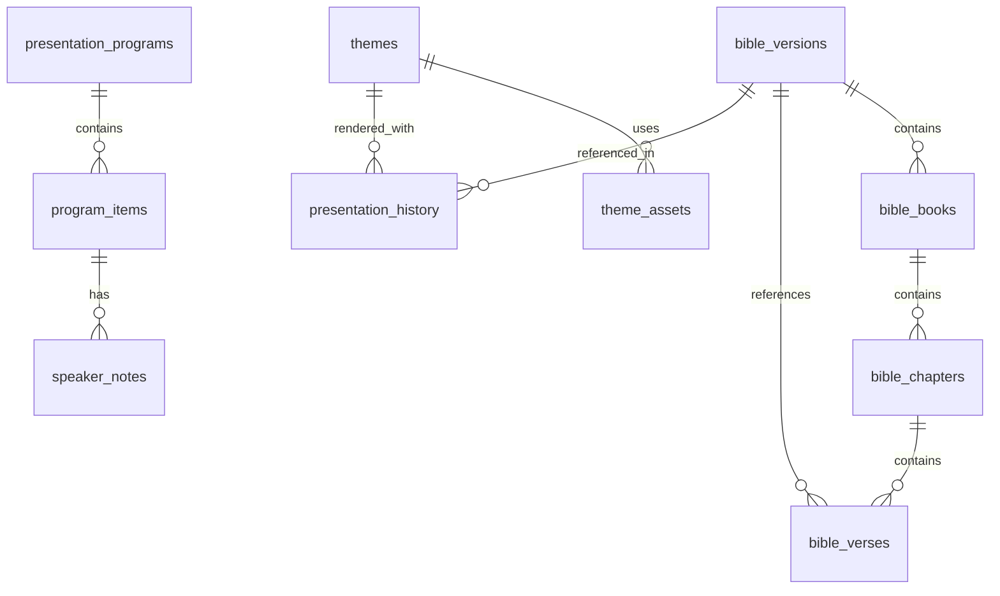

# Scripture Studio — Database Schema & Data Architecture

**Document Version:** 1.0.0  
**Status:** Approved for Architecture Review (Milestone M0)  
**Database Engine:** SQLite 3 (WAL Mode, synchronous = NORMAL)  
**ORM / Access Layer:** Typed SQLite Repository via `better-sqlite3`  

---

## 1. Database Architecture & Pragmas

Scripture Studio utilizes an embedded, local-first SQLite database (`scripture_studio.db`) residing in the user's local application data directory. To ensure peak performance during live church services and absolute immunity to power-loss corruption, the database initializes with the following production pragmas:

```sql
-- High-concurrency Write-Ahead Logging
PRAGMA journal_mode = WAL;

-- Safe durability balanced with high write throughput
PRAGMA synchronous = NORMAL;

-- Relational integrity enforcement
PRAGMA foreign_keys = ON;

-- UTF-8 string encoding for international scripture text
PRAGMA encoding = 'UTF-8';

-- Memory-mapped I/O for instant verse paging (256MB)
PRAGMA mmap_size = 268435456;

-- Cache size (64MB)
PRAGMA cache_size = -64000;
```

---

## 2. Entity-Relationship Diagram



---

## 3. Normalized Schema DDL

### 3.1 Core Scripture Tables

```sql
-- Schema version tracking
CREATE TABLE IF NOT EXISTS schema_migrations (
    version INTEGER PRIMARY KEY,
    applied_at TEXT NOT NULL DEFAULT (datetime('now'))
);

-- Registered Bible translations
CREATE TABLE IF NOT EXISTS bible_versions (
    id TEXT PRIMARY KEY,                       -- e.g. 'kjv', 'asv', 'cornilescu'
    name TEXT NOT NULL,                        -- 'King James Version'
    abbreviation TEXT NOT NULL,                -- 'KJV'
    language_code TEXT NOT NULL,               -- 'en', 'ro', 'es'
    direction TEXT NOT NULL DEFAULT 'ltr',     -- 'ltr' or 'rtl'
    license_type TEXT NOT NULL,                -- 'Public Domain', 'Creative Commons', 'Proprietary'
    copyright_notice TEXT,                     -- Full legal copyright line
    attribution_url TEXT,                      -- Source or licensor URL
    is_active INTEGER NOT NULL DEFAULT 1,      -- 1 = Enabled, 0 = Disabled
    installed_at TEXT NOT NULL DEFAULT (datetime('now'))
);

-- Canonical books for each translation
CREATE TABLE IF NOT EXISTS bible_books (
    id TEXT PRIMARY KEY,                       -- 'kjv_gen', 'kjv_mat'
    version_id TEXT NOT NULL,
    book_order INTEGER NOT NULL,               -- 1 to 66 (or extended canon)
    testament TEXT NOT NULL,                   -- 'OT' or 'NT'
    name TEXT NOT NULL,                        -- 'Genesis'
    abbreviation TEXT NOT NULL,                -- 'Gen'
    normalized_name TEXT NOT NULL,             -- Lowercase search token
    chapter_count INTEGER NOT NULL,
    FOREIGN KEY (version_id) REFERENCES bible_versions(id) ON DELETE CASCADE
);

-- Chapters table
CREATE TABLE IF NOT EXISTS bible_chapters (
    id TEXT PRIMARY KEY,                       -- 'kjv_gen_1'
    version_id TEXT NOT NULL,
    book_id TEXT NOT NULL,
    chapter_number INTEGER NOT NULL,
    verse_count INTEGER NOT NULL,
    FOREIGN KEY (version_id) REFERENCES bible_versions(id) ON DELETE CASCADE,
    FOREIGN KEY (book_id) REFERENCES bible_books(id) ON DELETE CASCADE,
    UNIQUE(version_id, book_id, chapter_number)
);

-- Core verse table
CREATE TABLE IF NOT EXISTS bible_verses (
    id TEXT PRIMARY KEY,                       -- 'kjv_gen_1_1'
    version_id TEXT NOT NULL,
    book_id TEXT NOT NULL,
    chapter_number INTEGER NOT NULL,
    verse_number INTEGER NOT NULL,
    verse_text TEXT NOT NULL,
    FOREIGN KEY (version_id) REFERENCES bible_versions(id) ON DELETE CASCADE,
    FOREIGN KEY (book_id) REFERENCES bible_books(id) ON DELETE CASCADE,
    UNIQUE(version_id, book_id, chapter_number, verse_number)
);

-- Indexes for instant verse queries
CREATE INDEX IF NOT EXISTS idx_verses_lookup 
ON bible_verses(version_id, book_id, chapter_number, verse_number);

CREATE INDEX IF NOT EXISTS idx_books_order 
ON bible_books(version_id, book_order);
```

### 3.2 Full-Text Search (FTS5) Virtual Table

```sql
-- FTS5 virtual table for sub-50ms full-text scripture searches
CREATE VIRTUAL TABLE IF NOT EXISTS bible_search_index USING fts5(
    verse_id UNINDEXED,
    version_id,
    book_name,
    chapter_number UNINDEXED,
    verse_number UNINDEXED,
    verse_text,
    tokenize = 'unicode61 remove_diacritics 2'
);
```

### 3.3 Theme & Asset Tables

```sql
-- Presentation themes
CREATE TABLE IF NOT EXISTS themes (
    id TEXT PRIMARY KEY,                       -- UUID or slug
    name TEXT NOT NULL,                        -- 'Sanctuary Deep Navy', 'Broadcast Lower Third'
    is_default INTEGER NOT NULL DEFAULT 0,
    is_system INTEGER NOT NULL DEFAULT 0,      -- 1 for built-in themes, 0 for user-created
    configuration_json TEXT NOT NULL,          -- Serialized typography, margins, backgrounds
    created_at TEXT NOT NULL DEFAULT (datetime('now')),
    updated_at TEXT NOT NULL DEFAULT (datetime('now'))
);

-- Linked theme assets (images, motion video loops)
CREATE TABLE IF NOT EXISTS theme_assets (
    id TEXT PRIMARY KEY,
    theme_id TEXT NOT NULL,
    asset_type TEXT NOT NULL,                  -- 'IMAGE', 'VIDEO', 'FONT'
    file_path TEXT NOT NULL,                   -- Absolute local path in appData/assets
    file_hash TEXT NOT NULL,                   -- SHA-256 integrity hash
    created_at TEXT NOT NULL DEFAULT (datetime('now')),
    FOREIGN KEY (theme_id) REFERENCES themes(id) ON DELETE CASCADE
);
```

### 3.4 Program & Playlist Tables

```sql
-- Service programs / playlists
CREATE TABLE IF NOT EXISTS presentation_programs (
    id TEXT PRIMARY KEY,
    name TEXT NOT NULL,                        -- 'Sunday Morning - 10:30 AM'
    description TEXT,
    created_at TEXT NOT NULL DEFAULT (datetime('now')),
    updated_at TEXT NOT NULL DEFAULT (datetime('now'))
);

-- Individual items within a program
CREATE TABLE IF NOT EXISTS program_items (
    id TEXT PRIMARY KEY,
    program_id TEXT NOT NULL,
    position INTEGER NOT NULL,                 -- Sort order (0, 1, 2...)
    item_type TEXT NOT NULL,                   -- 'SCRIPTURE', 'ANNOUNCEMENT', 'TITLE'
    reference_json TEXT NOT NULL,              -- Serialized reference structure
    custom_title TEXT,
    notes TEXT,
    FOREIGN KEY (program_id) REFERENCES presentation_programs(id) ON DELETE CASCADE
);

-- Speaker notes attached to program items (never projected to audience)
CREATE TABLE IF NOT EXISTS speaker_notes (
    id TEXT PRIMARY KEY,
    program_item_id TEXT NOT NULL,
    note_text TEXT NOT NULL,
    created_at TEXT NOT NULL DEFAULT (datetime('now')),
    updated_at TEXT NOT NULL DEFAULT (datetime('now')),
    FOREIGN KEY (program_item_id) REFERENCES program_items(id) ON DELETE CASCADE
);

CREATE INDEX IF NOT EXISTS idx_program_items_pos 
ON program_items(program_id, position);
```

### 3.5 Presentation History & Settings Tables

```sql
-- Audit log of live presentations
CREATE TABLE IF NOT EXISTS presentation_history (
    id TEXT PRIMARY KEY,
    reference_json TEXT NOT NULL,              -- Book, chapter, verse range
    translation_id TEXT NOT NULL,
    theme_id TEXT,
    presented_at TEXT NOT NULL DEFAULT (datetime('now')),
    FOREIGN KEY (translation_id) REFERENCES bible_versions(id) ON DELETE SET NULL,
    FOREIGN KEY (theme_id) REFERENCES themes(id) ON DELETE SET NULL
);

-- Display assignments
CREATE TABLE IF NOT EXISTS display_configurations (
    id TEXT PRIMARY KEY,                       -- e.g. 'audience_main', 'stage_monitor'
    display_id TEXT NOT NULL,                  -- OS display identifier
    display_name TEXT,
    role TEXT NOT NULL,                        -- 'AUDIENCE', 'STAGE', 'CONTROL'
    bounds_json TEXT NOT NULL,                 -- { x, y, width, height, scaleFactor }
    created_at TEXT NOT NULL DEFAULT (datetime('now')),
    updated_at TEXT NOT NULL DEFAULT (datetime('now'))
);

-- Key-value application settings
CREATE TABLE IF NOT EXISTS application_settings (
    setting_key TEXT PRIMARY KEY,
    setting_value_json TEXT NOT NULL,
    updated_at TEXT NOT NULL DEFAULT (datetime('now'))
);

-- Keyboard shortcut bindings
CREATE TABLE IF NOT EXISTS shortcut_configurations (
    id TEXT PRIMARY KEY,
    action_id TEXT NOT NULL UNIQUE,            -- 'TAKE_LIVE', 'FREEZE', 'NEXT_VERSE'
    key_combination TEXT NOT NULL,             -- 'F12', 'F9', 'Ctrl+F'
    is_global INTEGER NOT NULL DEFAULT 0,
    is_enabled INTEGER NOT NULL DEFAULT 1
);
```

---

## 4. Versification Differences & Cross-Version Alignment

Bible translations occasionally disagree on chapter/verse divisions (for example, the numbering of Psalm superscriptions in the Hebrew Masoretic text vs Western King James tradition, or Malachi 3/4 versification).
* Scripture Studio accommodates this via an optional cross-version alignment table:

```sql
CREATE TABLE IF NOT EXISTS versification_alignments (
    id TEXT PRIMARY KEY,
    source_version_id TEXT NOT NULL,
    source_book_id TEXT NOT NULL,
    source_chapter INTEGER NOT NULL,
    source_verse INTEGER NOT NULL,
    target_version_id TEXT NOT NULL,
    target_book_id TEXT NOT NULL,
    target_chapter INTEGER NOT NULL,
    target_verse INTEGER NOT NULL,
    FOREIGN KEY (source_version_id) REFERENCES bible_versions(id) ON DELETE CASCADE,
    FOREIGN KEY (target_version_id) REFERENCES bible_versions(id) ON DELETE CASCADE
);
```
When multi-version comparison is activated, the query engine checks `versification_alignments` to guarantee accurate parallel textual alignment across varied traditions.

---

## 5. Migration & Versioning Strategy

Database schema migrations are executed synchronously at application startup prior to initializing any window or engine:
1. `schema_migrations` table is inspected for the highest applied version.
2. Unapplied SQL migration files are executed sequentially inside an atomic transaction:
   ```typescript
   const applyMigration = db.transaction((migration) => {
     db.exec(migration.sql);
     db.prepare('INSERT INTO schema_migrations (version) VALUES (?)').run(migration.version);
   });
   ```
3. If any migration fails, the transaction is rolled back immediately, and the application halts startup with an informative recovery dialog rather than operating on a corrupted schema.

