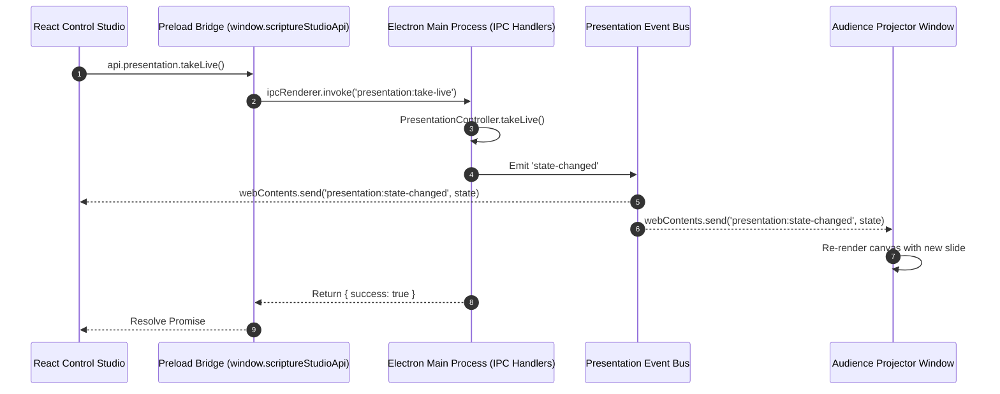

# Scripture Studio — Electron IPC Communication Contracts

**Document Version:** 1.0.0  
**Status:** Approved for Architecture Review (Milestone M0)  
**Security Boundary:** Context-Isolated Preload Bridge (`window.scriptureStudioApi`)  

---

## 1. IPC Architecture & Security Principles

Scripture Studio forbids direct, unconstrained access to Node.js APIs from any Electron renderer process. All interactions flow through an allowlisted, strongly typed bridge registered via `contextBridge.exposeInMainWorld()`.



---

## 2. Channel Namespace Conventions

| Channel Namespace | Purpose | Communication Pattern |
| :--- | :--- | :--- |
| `bible:*` | Bible queries, chapters, verses, versions, and imports. | Request / Response (`ipcRenderer.invoke`) |
| `search:*` | Reference parsing and FTS5 full-text queries. | Request / Response (`ipcRenderer.invoke`) |
| `presentation:*` | Slide transitions, Freeze, Hide, Clear, and AutoPlay. | Request / Response (`invoke`) + Event Push (`send`) |
| `display:*` | Monitor discovery, window placement, and status. | Request / Response (`invoke`) + Event Push (`send`) |
| `themes:*` | Theme CRUD, media asset linking, and styling export. | Request / Response (`ipcRenderer.invoke`) |
| `programs:*` | Service playlist creation, editing, and ordering. | Request / Response (`ipcRenderer.invoke`) |
| `history:*` | Presentation timeline audit queries and verse recall. | Request / Response (`ipcRenderer.invoke`) |
| `streaming:*` | NDI feed toggles, disk export status, and diagnostics. | Request / Response (`invoke`) + Event Push (`send`) |
| `settings:*` | System configuration, keyboard hotkeys, and locales. | Request / Response (`ipcRenderer.invoke`) |

---

## 3. Strongly Typed Contracts

### 3.1 Bible Channel Contracts

```typescript
// Channel: 'bible:get-versions'
export interface GetBibleVersionsRequest {}
export interface GetBibleVersionsResponse {
  versions: BibleVersionDto[];
}

// Channel: 'bible:get-chapter'
export interface GetBibleChapterRequest {
  versionId: string;
  bookId: string;
  chapterNumber: number;
}
export interface GetBibleChapterResponse {
  book: BibleBookDto;
  chapterNumber: number;
  verses: BibleVerseDto[];
}

// Channel: 'bible:get-verse-range'
export interface GetVerseRangeRequest {
  versionId: string;
  bookId: string;
  chapterNumber: number;
  startVerse: number;
  endVerse: number;
}
export interface GetVerseRangeResponse {
  verses: BibleVerseDto[];
}

// Channel: 'bible:import-version'
export interface ImportBibleVersionRequest {
  filePath: string;
  overrideLicense?: boolean;
}
export interface ImportBibleVersionResponse {
  success: boolean;
  versionId: string;
  verseCount: number;
  error?: string;
}
```

### 3.2 Search Channel Contracts

```typescript
// Channel: 'search:parse-reference'
export interface ParseReferenceRequest {
  rawQuery: string;
  defaultVersionId?: string;
}
export interface ParseReferenceResponse {
  isValid: boolean;
  parsedReference?: {
    bookId: string;
    bookName: string;
    chapter: number;
    startVerse: number;
    endVerse?: number;
  };
  suggestions?: string[];
}

// Channel: 'search:full-text'
export interface SearchFullTextRequest {
  query: string;
  versionId: string;
  page?: number;
  pageSize?: number;
}
export interface SearchFullTextResponse {
  totalResults: number;
  results: {
    verseId: string;
    bookName: string;
    chapterNumber: number;
    verseNumber: number;
    verseText: string;
    highlightedSnippet: string;
  }[];
}
```

### 3.3 Presentation Channel Contracts

```typescript
// Channel: 'presentation:get-state'
export interface GetPresentationStateResponse {
  state: PresentationStateDto;
}

// Channel: 'presentation:preview-reference'
export interface PreviewReferenceRequest {
  versionId: string;
  bookId: string;
  chapter: number;
  verse: number;
  endVerse?: number;
  themeId?: string;
}

// Channel: 'presentation:take-live'
export interface TakeLiveRequest {
  transitionType?: 'CUT' | 'FADE' | 'SLIDE';
  durationMs?: number;
}

// State Action Channels: 'presentation:freeze', 'presentation:unfreeze', 'presentation:hide', 'presentation:clear', 'presentation:next', 'presentation:prev'
export interface PresentationActionResponse {
  success: boolean;
  newState: PresentationStateDto;
  error?: string;
}

// Event Push: 'presentation:state-changed'
export interface PresentationStateDto {
  mode: 'IDLE' | 'PREVIEW' | 'LIVE' | 'FROZEN' | 'HIDDEN';
  isFrozen: boolean;
  isVisible: boolean;
  activeThemeId: string;
  previewSlide: SlideContentDto | null;
  liveSlide: SlideContentDto | null;
  currentProgramId: string | null;
  currentProgramItemIndex: number | null;
  lastUpdatedTimestamp: number;
}

export interface SlideContentDto {
  referenceDisplay: string;         // e.g. "Romans 8:28"
  versionAbbreviation: string;      // e.g. "KJV"
  verses: {
    number: number;
    text: string;
  }[];
  multiVersionSlots?: {
    versionAbbreviation: string;
    text: string;
  }[];
  customTitle?: string;
  notes?: string;
}
```

### 3.4 Display Management Contracts

```typescript
// Channel: 'display:get-displays'
export interface GetDisplaysResponse {
  displays: {
    id: string;
    name: string;
    bounds: { x: number; y: number; width: number; height: number };
    isPrimary: boolean;
    scaleFactor: number;
    assignedRole: 'CONTROL' | 'AUDIENCE' | 'STAGE' | 'UNASSIGNED';
  }[];
}

// Channel: 'display:assign-role'
export interface AssignDisplayRoleRequest {
  displayId: string;
  role: 'AUDIENCE' | 'STAGE' | 'UNASSIGNED';
}

// Event Push: 'display:topology-changed'
export interface DisplayTopologyChangedEvent {
  connectedCount: number;
  hasAudienceDisplay: boolean;
  hasStageDisplay: boolean;
}
```

### 3.5 Streaming & Export Contracts

```typescript
// Channel: 'streaming:get-status'
export interface GetStreamingStatusResponse {
  ndiActive: boolean;
  ndiStreamName: string;
  diskExportActive: boolean;
  diskExportPath: string;
  lastFrameTimestamp: number;
}

// Channel: 'streaming:toggle-ndi'
export interface ToggleNdiRequest {
  enabled: boolean;
  streamName?: string;
}
```

---

## 4. Preload API Surface (`window.scriptureStudioApi`)

The preload script binds the following immutable API surface into the renderer's global `window` object:

```typescript
export interface ScriptureStudioApi {
  bible: {
    getVersions(): Promise<GetBibleVersionsResponse>;
    getChapter(req: GetBibleChapterRequest): Promise<GetBibleChapterResponse>;
    getVerseRange(req: GetVerseRangeRequest): Promise<GetVerseRangeResponse>;
    importVersion(req: ImportBibleVersionRequest): Promise<ImportBibleVersionResponse>;
  };
  search: {
    parseReference(req: ParseReferenceRequest): Promise<ParseReferenceResponse>;
    searchFullText(req: SearchFullTextRequest): Promise<SearchFullTextResponse>;
  };
  presentation: {
    getState(): Promise<GetPresentationStateResponse>;
    previewReference(req: PreviewReferenceRequest): Promise<void>;
    takeLive(req?: TakeLiveRequest): Promise<PresentationActionResponse>;
    freeze(): Promise<PresentationActionResponse>;
    unfreeze(): Promise<PresentationActionResponse>;
    hide(): Promise<PresentationActionResponse>;
    clear(): Promise<PresentationActionResponse>;
    next(): Promise<PresentationActionResponse>;
    prev(): Promise<PresentationActionResponse>;
    onStateChanged(callback: (state: PresentationStateDto) => void): () => void;
  };
  display: {
    getDisplays(): Promise<GetDisplaysResponse>;
    assignRole(req: AssignDisplayRoleRequest): Promise<void>;
    onTopologyChanged(callback: (evt: DisplayTopologyChangedEvent) => void): () => void;
  };
  themes: {
    list(): Promise<ThemeDto[]>;
    save(theme: ThemeDto): Promise<void>;
    delete(id: string): Promise<void>;
  };
  programs: {
    list(): Promise<ProgramDto[]>;
    save(program: ProgramDto): Promise<void>;
    delete(id: string): Promise<void>;
  };
  streaming: {
    getStatus(): Promise<GetStreamingStatusResponse>;
    toggleNdi(req: ToggleNdiRequest): Promise<void>;
  };
}
```

---

## 5. Input Validation & Error Handling

To guard against malicious or corrupt payloads:
1. Every IPC request is runtime-validated using Zod schemas in the Electron Main process prior to invoking domain logic.
2. Unhandled errors are caught and sanitized in the main process, returning structured errors (`{ success: false, error: string }`) instead of propagating unhandled promise rejections or raw stack traces.

