# Scripture Studio — Engineering Roadmap & Milestone Gates

**Document Version:** 1.0.0  
**Status:** Approved for Architecture Review (Milestone M0)  
**Execution Model:** Phased Milestone Delivery with Strict Quality Gating  

---

## 1. Roadmap Overview & Timeline

Scripture Studio is developed in sequential, verifiable milestones. No milestone begins until the preceding milestone's Quality Gates and acceptance criteria have been demonstrably satisfied.

```mermaid
flowchart LR
    M0["M0: Discovery & Architecture"] --> M1["M1: Foundation & Monorepo"]
    M1 --> M2["M2: Application Shell & UI"]
    M2 --> M3["M3: Bible Engine & Importer"]
    M3 --> M4["M4: Search Engine (FTS5)"]
    M4 --> M5["M5: Presentation Engine"]
    M5 --> M6["M6: Programs, Themes & Media"]
    M6 --> M7["M7: Multi-Monitor & Stage"]
    M7 --> M8["M8: Streaming & Broadcast"]
    M8 --> M9["M9: Cloud & Extensions"]
    M9 --> M10["M10: Release & Installer"]
```

---

## 2. Milestone Breakdown & Exit Criteria

### Milestone M0: Product Discovery & Architecture
* **Focus:** Functional parity discovery against documented BibleShow capabilities, architectural modeling, database design, IPC contracts, and threat analysis.
* **Deliverables:**
  - `docs/PRD.md`
  - `docs/FEATURE-MATRIX.md`
  - `docs/ARCHITECTURE.md`
  - `docs/AGENT-OWNERSHIP.md`
  - `docs/DATABASE.md`
  - `docs/IPC-CONTRACTS.md`
  - `docs/UI-SPECIFICATION.md`
  - `docs/SECURITY.md`
  - `docs/TESTING.md`
  - `docs/ROADMAP.md`
  - `docs/RISK-REGISTER.md`
  - `docs/README.md`
* **Exit Gate:** All 12 discovery artifacts approved; architecture reviewed; zero code implementation until gate is verified.

---

### Milestone M1: Project Foundation & Desktop Shell
* **Focus:** Establish monorepo workspace, core compilation infrastructure, secure Electron main/preload skeleton, and SQLite database connectivity.
* **Key Tasks:**
  1. Initialize `pnpm` workspaces (`apps/desktop`, `packages/*`).
  2. Configure root `tsconfig.base.json` with strict type-checking.
  3. Set up Vite + React 19 + TypeScript build pipeline for Electron.
  4. Implement secure Electron main process with sandboxed preload and allowlisted IPC dispatcher.
  5. Configure `better-sqlite3` database initialization with WAL pragmas and migration runner.
  6. Set up Vitest test harness and CI workflow.
* **Exit Gate:** Application compiles and launches on Windows desktop; initial unit tests pass; baseline IPC round-trip verified.

---

### Milestone M2: Application Shell & UI Design System
* **Focus:** Operator interface shell, navigation layout, resizable panels, and design system.
* **Key Tasks:**
  1. Implement `packages/ui-library` with design tokens (colors, typography, elevation).
  2. Build Control Studio shell: Navigation Rail (Sidebar), Main Workspace, Right Control Panel, Bottom Control Bar.
  3. Implement panel resize handlers and persistence of operator layout preferences.
  4. Create Dark / Light theme tokens optimized for dark media booth environments.
* **Exit Gate:** Operator can navigate all major sidebar workspaces; resizable layout survives app restarts; zero visual layout breaks.

---

### Milestone M3: Bible Engine, Importer & Navigation
* **Focus:** Bible data modeling, import parsers, canonical book/chapter browsing, and multi-version comparison.
* **Key Tasks:**
  1. Implement `packages/database` repositories for `bible_versions`, `bible_books`, `bible_verses`.
  2. Implement `packages/bible-importer` supporting open-format JSON, XML (Zefania), and OSIS/USFM formats.
  3. Build Bible Reader UI with canonical 66-book selector, chapter grid, and virtualized verse reader.
  4. Implement continuous and discontinuous verse range selection.
  5. Implement multi-version comparison view (rendering up to 4 translations side by side).
* **Exit Gate:** Public-domain translation (e.g. KJV / ASV) imports in < 3s, browses smoothly, and supports 4-translation comparison.

---

### Milestone M4: Scripture Search & Reference Parser
* **Focus:** Sub-100ms scripture lookups, grammatical reference parser, and SQLite FTS5 full-text queries.
* **Key Tasks:**
  1. Implement `packages/scripture-search` natural reference parser (handling abbreviations, separators, verse spans).
  2. Configure SQLite FTS5 virtual table with `unicode61` tokenizer.
  3. Build Search UI with instant live suggestions, highlighted search snippets, and book filters.
  4. Implement keyboard-driven quick reference jump (`F5` / `Ctrl+F`).
* **Exit Gate:** Reference parsing achieves 100% pass rate on 250+ benchmark references; FTS5 searches execute in < 100ms.

---

### Milestone M5: Presentation Engine & Live Controls
* **Focus:** Centralized presentation state machine, dual-stage Preview vs Live pipeline, and transport controls.
* **Key Tasks:**
  1. Implement `packages/presentation-engine` state machine (`IDLE`, `PREVIEW`, `LIVE`, `FROZEN`, `HIDDEN`).
  2. Build atomic command queue: `takeLive()`, `freeze()`, `unfreeze()`, `hide()`, `clear()`, `next()`, `prev()`.
  3. Create real-time presentation event bus broadcasting state across all Electron `webContents`.
  4. Build operator Preview pane with WYSIWYG scaling and high-visibility status indicators.
* **Exit Gate:** E2E presentation test proves complete isolation between preview browsing and frozen live output; transition latency < 100ms.

---

### Milestone M6: Programs, Themes & History Log
* **Focus:** Service playlist management, AutoPlay cycling, rich theme styling, video backgrounds, and presentation history.
* **Key Tasks:**
  1. Implement `packages/theme-engine` supporting typography, outlines, drop shadows, safe margins, and lower thirds.
  2. Implement `packages/media-engine` supporting solid, gradient, image, and seamless looping video backgrounds.
  3. Build WYSIWYG Theme Editor with live preview canvas.
  4. Build Program / Playlist Manager with drag-and-drop reordering, verse grouping, and persistence.
  5. Implement AutoPlay cycling with configurable per-slide dwell time.
  6. Implement Presentation History log with one-click re-projection.
* **Exit Gate:** Playlists and custom themes persist across restarts; 1080p video backgrounds loop without frame drops or memory growth.

---

### Milestone M7: Advanced Desktop, Multi-Monitor & Stage Display
* **Focus:** Windows display topology management, frameless audience output, stage confidence monitor, hotkeys, and RTL.
* **Key Tasks:**
  1. Implement `packages/display-manager` monitoring Windows physical displays via Electron `screen` API.
  2. Build frameless, borderless Audience Output window pinned to target monitor coordinates.
  3. Build Stage Confidence Display window rendering large-font current verse, upcoming next verse, sermon timer, and private notes.
  4. Implement safe disconnect and reconnect recovery for external projectors.
  5. Implement global and local keyboard shortcuts (`packages/keyboard-shortcuts`).
  6. Implement Right-to-Left (RTL) text rendering for Hebrew, Arabic, and Farsi scriptures.
* **Exit Gate:** Audience and Stage displays update in lockstep (<16ms skew); hot-unplugging external monitor does not crash the app.

---

### Milestone M8: External Streaming & Broadcast Integrations
* **Focus:** Zero-latency broadcast integrations with OBS Studio, vMix, and Wirecast.
* **Key Tasks:**
  1. Implement real-time atomic disk export of `current_verse.xml` and transparent `current_slide.png`.
  2. Implement modular NDI (Network Device Interface) video streaming adapter with alpha transparency.
  3. Build broadcast diagnostics panel displaying stream health and export status.
* **Exit Gate:** vMix / OBS successfully reads XML/PNG dynamic titles; NDI stream is discovered and rendered cleanly on local LAN.

---

### Milestone M9: Cloud Services & Modern Extensions
* **Focus:** Optional cloud synchronization, mobile LAN remote, and AI study companion.
* **Key Tasks:**
  1. Build optional ASP.NET Core REST API (`backend/ScriptureStudio.Api`) for theme and sermon sync.
  2. Implement local WebSocket server for mobile web browser remote control over church Wi-Fi.
  3. Build optional AI study assistant validated against installed local Bible database.
* **Exit Gate:** Disconnecting internet has zero impact on core desktop presentation; mobile remote steps through slides smoothly.

---

### Milestone M10: Production Hardening, Installer & Release
* **Focus:** Security audit, long-session stress testing, Windows installer generation, and release documentation.
* **Key Tasks:**
  1. Perform 4-hour continuous presentation endurance test.
  2. Run automated security and dependency vulnerability audits.
  3. Configure Electron Builder to generate signed Windows NSIS and MSI installers.
  4. Validate clean installation, update, and uninstall flows on clean Windows 10/11 VMs.
  5. Compile final user manual, keyboard shortcut cheat-sheet, and release notes.
* **Exit Gate:** Zero open P0/P1 defects; signed Windows installer installs and passes all acceptance scenarios.

