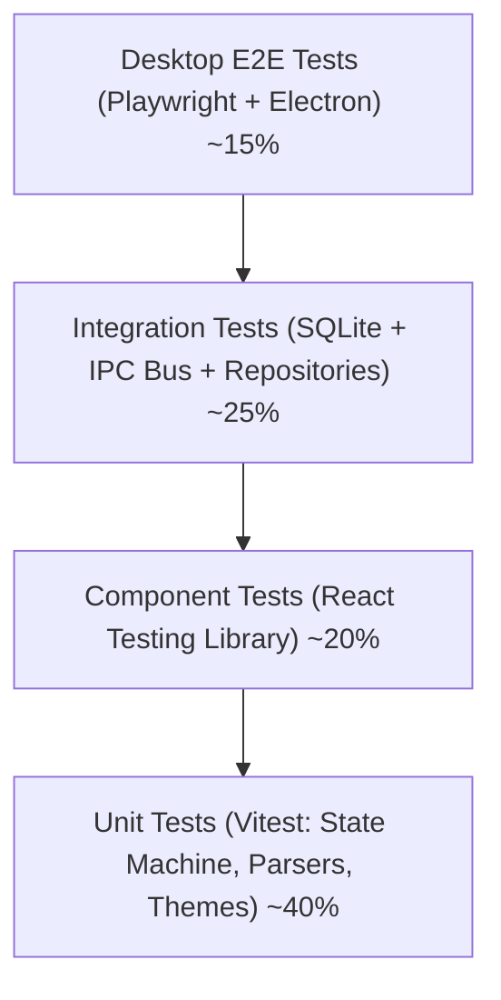

# Scripture Studio — Test Plan, Strategy & Quality Gates

**Document Version:** 1.0.0  
**Status:** Approved for Architecture Review (Milestone M0)  
**Test Frameworks:** Vitest (Unit/Integration), React Testing Library (Components), Playwright (E2E & Desktop Electron)  

---

## 1. Testing Philosophy for Live Production Software

In a corporate SaaS application, a minor rendering glitch or 500ms delay might be tolerated. In live church presentation software, projecting the wrong scripture, freezing an audience display during praise and worship, or crashing the video feed during a sermon is considered an operational failure.

Testing in Scripture Studio adheres to three foundational tenets:
1. **Zero-Glitch Live Transition:** Keystrokes must commit preview to live in under 100ms with 100% state determinism.
2. **Offline Independence Verification:** Automated CI tests must run with network interfaces disabled to prove zero cloud dependencies.
3. **Resilient Window Topology:** Electron multi-window synchronization must survive simulated monitor disconnects and rapid HDMI hot-plugging.

---

## 2. Test Architecture & Pyramidal Distribution

### 2.1 Coverage Targets
- **`packages/presentation-engine`:** **100% statement and branch coverage.** Every state transition, action, and edge case must be unit-tested.
- **`packages/bible-engine` & `packages/scripture-search`:** **≥95% coverage.** Exhaustive reference parsing and query fuzz testing.
- **`packages/database` & SQLite repositories:** **≥90% coverage.** Migration rollback, concurrency, and constraint enforcement.
- **UI Components & Renderers:** **≥80% coverage.**

---

## 3. Detailed Test Categories & Methodology

### 3.1 Unit Testing (Vitest)
* **Reference Grammar Parser:** Tested against a corpus of 250+ valid and invalid scripture references:
  - Standard references (`John 3:16`, `1 Cor 13:4-8`).
  - Abbreviated books (`Rom 8:28`, `Phil 4:13`, `Jas 1:2`).
  - Varied punctuation (`Gen 1.1`, `Jn 3 16`, `Exod 20: 1-17`).
  - Ambiguous / fuzzy inputs (`Jud` disambiguation, misspelled book names).
* **Presentation State Machine:**
  - Verify `takeLive()`, `freeze()`, `unfreeze()`, `hide()`, `clear()`.
  - Ensure command queuing: When 10 `next()` commands are dispatched in 100ms, state transitions execute sequentially without dropped frames or inconsistent indices.
* **Theme Compilers:**
  - Verify CSS generation for fonts, text shadows, outlines, and safe-margin calculations across 16:9, 4:3, and lower-third aspect ratios.

### 3.2 Integration Testing (Better-SQLite3 & IPC)
* **Database Migrations:**
  - Test forward migration from version 0 to current schema.
  - Test transactional rollback when an intentional syntax error is injected into a migration step.
* **Bible Importer Pipeline:**
  - Import full test translations (e.g. KJV Public Domain with 31,102 verses).
  - Verify verse count, chapter boundary integrity, and book ordering.
  - Verify atomic rollback if import process is interrupted midway.
* **FTS5 Search Performance:**
  - Benchmark queries: exact phrase, multi-word `AND`, prefix `*`.
  - Assert query latency is strictly under 100ms on a 50MB SQLite database.

### 3.3 Component Testing (React Testing Library)
* **Virtualized Scripture Reader:** Verify that scrolling through 176 verses of Psalm 119 maintains 60 FPS and only renders DOM elements currently in the viewport.
* **Theme Editor Controls:** Verify slider adjustments immediately update CSS preview canvas styles.
* **Program Playlist:** Verify drag-and-drop item reordering dispatches correct positional indices.

### 3.4 Desktop E2E Testing (Playwright + Electron)
* Runs actual Electron instances with separate `BrowserWindow` handles for:
  - `controlStudioWindow`
  - `audienceOutputWindow`
  - `stageDisplayWindow`
* Directly asserts that state broadcast over IPC reaches and renders in audience and stage windows simultaneously.

---

## 4. Critical E2E Test Scenarios

### Scenario 1 — Scripture Presentation (Golden Path)
1. Launch Scripture Studio in Electron.
2. Navigate to Bible tab.
3. Select version: `KJV`, Book: `John`, Chapter: `3`, Verse: `16`.
4. Verify Preview Pane renders: *"For God so loved the world..."*.
5. Assert Audience Output Window DOM contains no scripture text (remains `IDLE`).
6. Click `Take Live` (`F12`).
7. Assert Audience Output Window DOM updates with John 3:16 text within 100ms.
8. Assert Stage Display Window DOM renders John 3:16 in Current Verse and John 3:17 in Next Verse.
9. Assert `presentation_history` table contains a new record for `KJV John 3:16`.

### Scenario 2 — Freeze and Hide Independence
1. With John 3:16 live on audience output, trigger `Freeze` (`F9`).
2. Assert Presentation State is `FROZEN`.
3. In Control Studio, navigate to `Romans 8:28` and update Preview.
4. Verify Audience Output Window DOM **still displays John 3:16** (unaffected by operator navigation).
5. Trigger `Hide` (`F10`).
6. Verify Audience Output Window DOM fades to blank/black.
7. Trigger `Restore` (`F10`).
8. Verify Audience Output Window DOM restores John 3:16.
9. Trigger `Take Live` (`F12`).
10. Verify Audience Output Window now updates to `Romans 8:28`.

### Scenario 3 — Multi-Monitor Hot-Unplug & Recovery
1. Mock Electron `screen` API with 2 physical displays (Display 1: Control, Display 2: Audience).
2. Open Audience Output on Display 2.
3. Trigger simulated OS event: `display-removed` for Display 2.
4. Verify application does not crash.
5. Verify Control Studio displays amber notification: *"Audience Display Disconnected"*.
6. Trigger simulated OS event: `display-added` for Display 2.
7. Click "Restore Output".
8. Verify Audience Output re-attaches to Display 2 bounds with active live slide preserved.

### Scenario 4 — 100% Offline Sunday Morning Reliability
1. Disconnect network adapters (`mockOfflineMode = true`).
2. Perform reference search for `Psalm 23:1`.
3. Create a service playlist with 5 scriptures.
4. Trigger AutoPlay through all 5 items.
5. Take slides live.
6. Restart application.
7. Verify all programs, themes, and presentation history are fully preserved.

### Scenario 5 — Data Import Interruption & Integrity
1. Initiate import of a 10MB Bible XML file.
2. Invalidate process midway via artificial thread termination or abort signal.
3. Re-open database.
4. Assert database is in consistent state: zero partial records inserted into `bible_verses` or `bible_books`.
5. Re-run import of the same translation; verify successful clean installation without constraint errors.

---

## 5. Performance Benchmarks & Engineering Targets

| Metric | Target Threshold | Validation Method |
| :--- | :--- | :--- |
| **Warm Scripture Lookup** | < 50 ms (Max 100 ms) | Vitest benchmark querying 100 random verses. |
| **Full-Text Search (FTS5)** | < 100 ms (Max 150 ms) | Playwright search benchmark on 31,102 verses. |
| **Preview-to-Live Latency** | < 80 ms (Max 100 ms) | High-resolution performance timer between hotkey and DOM paint. |
| **Video Background Looping** | Zero stutter, 0 dropped frames | Performance memory profiler over 30-minute continuous loop. |
| **Memory Leak Resistance** | < 15MB delta over 4 hours | Continuous slide cycling test recording heap snapshot deltas. |

